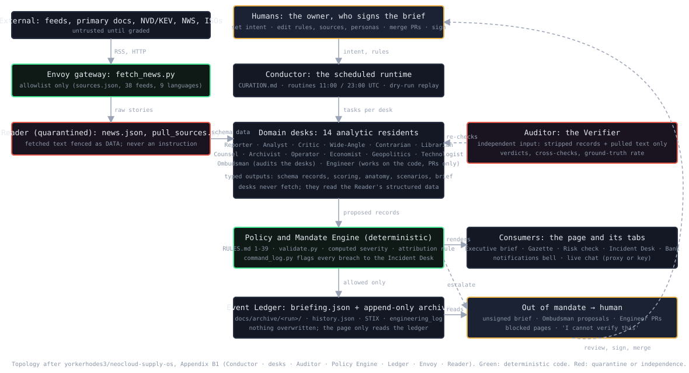
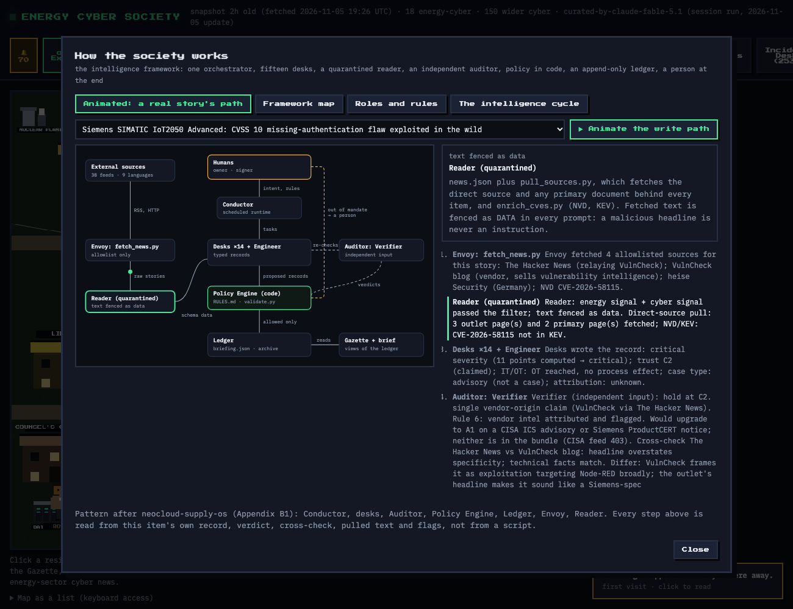
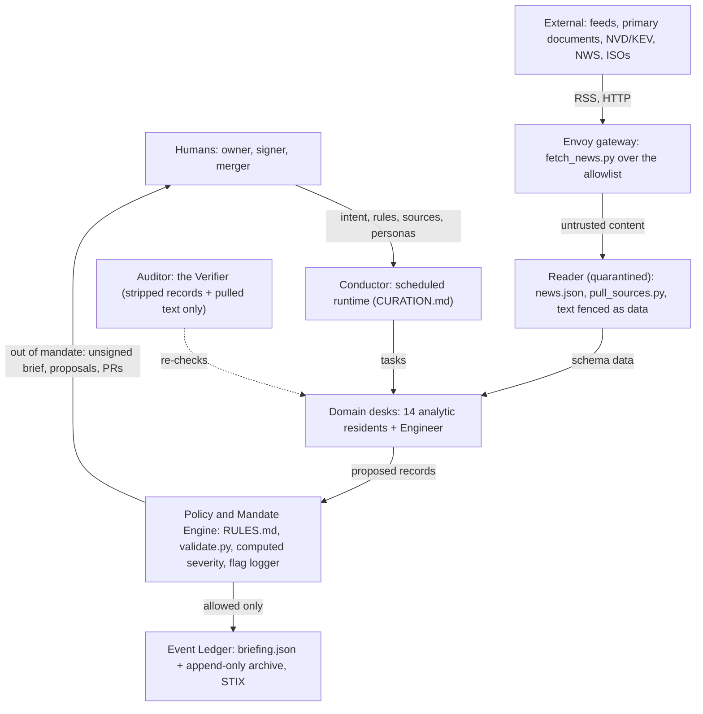

# Energy Cyber Society

A virtual town of five LLM agents who read the day's cybersecurity news about the
energy sector, worldwide with a focus on the United States, and argue about it.
Walk around, overhear them, click one to talk.

**Live demo:** https://carolina-moron.github.io/energy-cyber-society/ 

## The residents

All five run in the same runtime over the same news bundle. Each has one job,
which is why they disagree.

| Resident | Role | Job |
|---|---|---|
| Dana Okafor | The Reporter | Gathers and summarizes the day's energy-cyber stories, US first. Separates confirmed from claimed. |
| Mateo Reyes | The Analyst | Actors, tradecraft, IT-versus-OT impact, attribution confidence. |
| Priya Venkataraman | The Media Critic | What is the bias or incentive of each source? Who owns it, what does it overplay? |
| Samir Haddad | The Wide-Angle | What else happened in cyberspace at the same time that could spill into energy? |
| Ingrid Solberg | The Contrarian | Who was *not* affected, and why? Where is the coverage overstating impact? |

## How it works

1. `scripts/fetch_news.py` reads only the feeds in `sources.json` (the credible-source
   allowlist, each with a bias note) and keeps stories that have both an energy and a
   cyber signal. Everything else from the same window goes in a "wide" bucket.
2. `scripts/run_agents.py` runs the five personas in `agents/personas.json` on the Claude
   API: a briefing each, canned answers to their suggested questions, a speech-bubble line,
   and five pairwise conversations. Output: `docs/data/briefing.json`.
   Without `ANTHROPIC_API_KEY` it writes an honest headlines-only fallback.
3. Unattended runs, twice a day (06:00 and 18:00 US East), either way:
   - `.github/workflows/daily.yml` runs both scripts on the Claude API (needs an
     `ANTHROPIC_API_KEY` secret), or
   - a claude.ai scheduled routine (`scripts/routine.json`) clones the repo and does the
     curation itself following `CURATION.md`; no API key needed, the agent is the model.
   The sixth resident, the Verifier, audits every item on each run: source tier,
   corroboration, claim-versus-confirmed, staleness, and what changed since last time.
4. `docs/` is the GitHub Pages site: a canvas pixel town, no framework, no build step.

### Live chat

By default residents answer their suggested questions from the day's briefing. To ask
anything, open **Settings** in the page and add either an Anthropic API key (sent straight
from the browser to Anthropic) or an OpenAI-compatible proxy URL such as
[pages-ai-proxy](https://github.com/Ethical-Tech-CoLab/pages-ai-proxy). Settings live in
your browser's localStorage only.

## Run locally

```bash
pip install feedparser anthropic
python scripts/fetch_news.py 48          # hours of news to read
ANTHROPIC_API_KEY=sk-ant-... python scripts/run_agents.py
cd docs && python -m http.server 8765    # open http://localhost:8765
```

## The intelligence schema and sourcing rules

Each story the agents keep becomes a structured record (`agents/schema.json`): event core,
energy subsector and value-chain segment, IT-versus-OT impact, actor and attribution
confidence, CVE/KEV, impact, geopolitical and regulatory context, Admiralty-style source
reliability and credibility, a so-what line and a recommended action. The **Briefing board**
in the page shows these ranked by severity. The residents' shared rules
(`agents/personas.json`) carry the sourcing discipline: primary documents for legal claims,
vendor intel attributed and flagged, `[inference]`/`[unverified]` labels, "I cannot verify
this" instead of guesses.

Two companion files for using the same rigor in a Claude Project:
`docs/claude-project-instructions.md` (paste as Project instructions) and
`docs/energy-cyber-source-registry.md` (tiered registry, upload to Project knowledge).

## Pull the direct source, then verify one against the other

`scripts/pull_sources.py` fetches every source URL behind every board item, keeps the
sentences that match the item, and follows links to primary documents (CISA, FERC, NERC,
TSA, vendor advisories, victim statements). The board shows the pulled excerpts under
"Direct source" and the Verifier's cross-check ("Agree / Differ / verdict") next to each
item. The board's rubric keeps **importance** (severity) and **correctness** (source tier,
corroboration, Verifier verdict) as separate columns, so a critical-but-single-source item
and a confirmed-but-minor one are never confused.

## Views in the page

Final output: Executive brief (unsigned until a person signs) · Risk check (CIO) · How the society
works · Regulations · Grid & weather (US and worldwide) · Summary · Chatter · Methodology · Where
to look (with the verified source catalogue) · Limitations · Rules · Incident Desk · Agent Register ·
Dashboard (drill-down, timelines) · Collections (TI cut, STIX) · Research · Scenarios · Human touch ·
Briefing board · Today's wire · Sources & references · History (archive) · Cost & energy · Bank ·
Notifications bell · Settings.
On the map: seven buildings (click for purpose, data flow and naming), nine energy
facilities (click for the sector dossier: variables, IT/OT/PIT layers, vulnerabilities,
attack types, how a breach happens, live and background cases), and the newsstand, which
opens the Gazette, a broadsheet printed from the same data. `docs/data/stix.json` is a STIX
2.1 export of the board.

## Archive

`docs/archive/<run>/` keeps every run's complete data set, rules and playbook as published;
`docs/ARCHIVE.md` is the index; the History tab and `gazette.html?run=<run>` open past editions.
Git history is the second copy. Nothing is overwritten.

## Analysis procedure

`INTELLIGENCE_ANALYSIS.md`: the ten-step procedure an investigative agent follows here,
synthesised from the intelligence cycle, ICD 203 analytic standards, ICD 206 sourcing,
Admiralty grading, structured analytic techniques and the FBI/CISA advisory format.

## Grid & weather, US and worldwide

`scripts/build_plants.py` compacts the WRI Global Power Plant Database (CC BY 4.0) into
`docs/data/plants.json`; the tab draws 4,360 plants worldwide with live US ISO load, NWS alerts,
GDACS global alerts and hub forecasts.

## US grid & weather

`scripts/grid_weather.py` pulls live ISO load (gridstatus library), energy-relevant NWS alerts and
3-day forecasts for energy hubs into `docs/data/grid_weather.json`; the **US grid & weather** tab
maps them and links Grid Status's plant map (which cannot be embedded). Weather is context, never
cyber evidence.

## Risk check for a CIO

The **Risk check (CIO)** tab takes an organization's profile (facilities, products, environment
patterns, size, region) and scores exposure from this week's board, the facility dependency
stacks and the research record, then ranks what to do first with the evidence behind each line.
The profile stays in the browser; the result exports as Markdown. A ranking aid, not an audit.

## The Engineer

A fifteenth resident works on this codebase: `ENGINEERING.md` is the playbook, `scripts/ux_audit.py`
finds UX and accessibility work, `scripts/routine_engineer.json` is the daily cloud routine. It opens
pull requests and never merges; the owner reviews.

## How the society works (the intelligence framework)

The town runs the Conductor–desks–Auditor–Policy Engine–Ledger–Envoy–Reader topology from
[neocloud-supply-os](https://github.com/yorkerhodes3/neocloud-supply-os) Appendix B1:

| Role | In this society | Rule |
|---|---|---|
| Humans | the owner: edits rules, sources, personas, dossiers; merges PRs; signs the brief | 31 |
| Conductor | the scheduled runtime following `CURATION.md`, twice a day | 29 |
| Envoy | `scripts/fetch_news.py` over the allowlist (38 feeds, 9 languages) | 1 |
| Reader (quarantined) | `news.json`, `pull_sources.py`, `enrich_cves.py`; fetched text fenced as data | 7, 25 |
| Desks | 14 analytic residents + the Engineer; typed records against `agents/schema.json` | 13–15 |
| Auditor | the Verifier, on stripped records and pulled text only | 16–21 |
| Policy Engine | `RULES.md`, `validate.py`, computed severity, the attribution rule, the flag logger | 30 |
| Ledger | `briefing.json`, `docs/archive/<run>/`, history, STIX, engineering log; append-only | — |
| Out of mandate | the unsigned brief, Ombudsman proposals, Engineer PRs, blocked pages, "I cannot verify this" | 9 |



In the page, the same framework is interactive: a real story's path animated node to node, the map, the roles, the cycle.



Diagram source: `docs/topology.svg`. Procedure: `INTELLIGENCE_ANALYSIS.md`.

## Process topology

After [neocloud-supply-os](https://github.com/yorkerhodes3/neocloud-supply-os) Appendix B1. The diagram is `docs/topology.svg` (Methodology tab).



## Research

`agents/research/` holds user-provided research transcribed to data. The Global Energy Cyber
Threat Intelligence Report (cut-off 2026-11-04) supplies twenty case studies, the counting and
attribution rules now in `RULES.md` §4a, and the Research tab.

## Decisions log

`DECISIONS.md`: every question asked during the build, the answer, and where it lives in the
product, plus the decisions the assistant made unasked so they can be reversed.

## Review and presentation

`REVIEW.md` is a critical peer review: blockers, majors, minors, what is missing, what is
sound. `PRESENTATION.md` is a timed ten-minute spoken walkthrough for someone who has never
seen the project, with a guideline for presenters.

## Operating it

- Scheduled runs: two claude.ai routines (curation at 11:00 and 23:00 UTC; the Engineer at
  14:00 UTC) clone this repo. The curation routine aborts, correctly, while the cloud sandbox
  blocks the feed hosts; allow them in the environment settings, or use the GitHub Actions
  workflow (`.github/workflows/daily.yml`, needs the `ANTHROPIC_API_KEY` secret).
- Push to both remotes from the local clone: `git push etc main` (this repo) and
  `git push origin main` (the private mirror at carolina-moron/energy-cyber-society).
- Check everything that needs no key: `bash scripts/test_all.sh`.
- The Engineer opens pull requests and never merges; a person reviews.

## Backlog

See `BACKLOG.md`: everything requested, what shipped, what is blocked on a person, what the
scheduled runs will do on their own.

## Adding a source

Add it to `sources.json` with a `bias_note`. The Media Critic reads those notes; a source
without one is a source nobody is thinking critically about.

## Known limits

- CISA's feeds return 403 to some clients; the fetcher logs the error and moves on.
- NERC, Reuters, ENISA and Dragos have no working public RSS as of November 2026.
- The energy filter is keyword-based, so an occasional off-topic story slips in and the
  Contrarian is there to say so.
