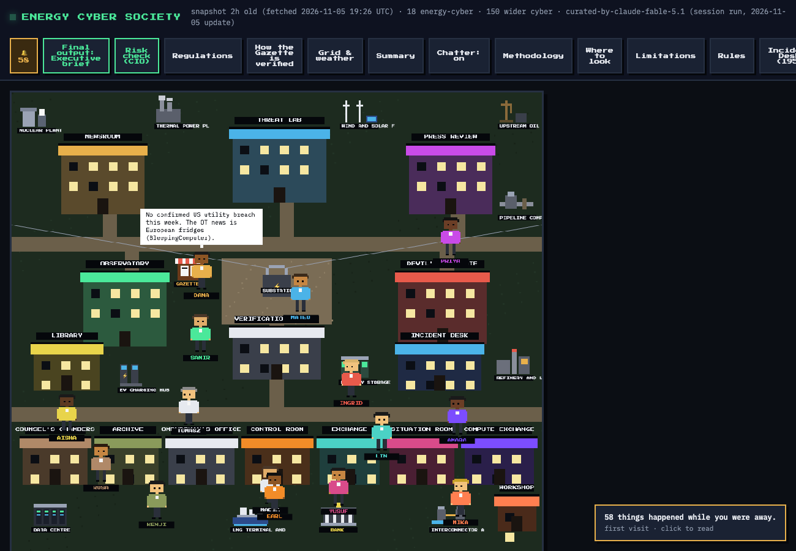
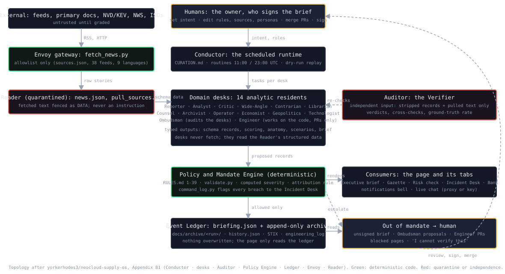
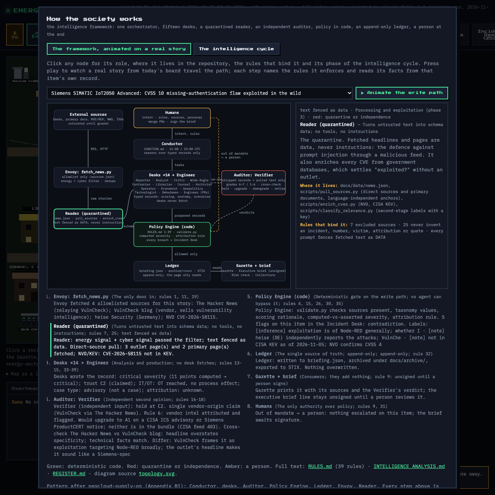
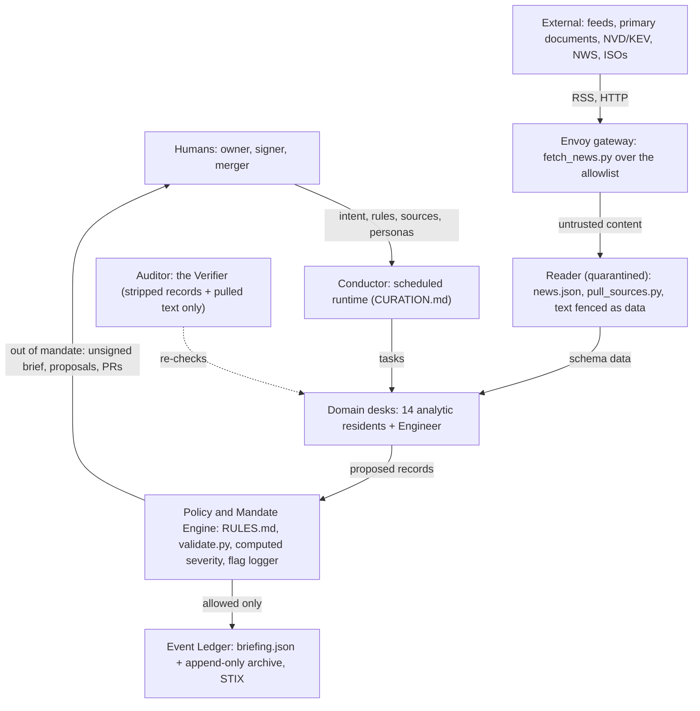

# Energy Cyber Society

A virtual town of **fifteen LLM agents** who read the day's cybersecurity news about the
energy sector, worldwide with a focus on the United States, verify it against primary
sources, and argue about it. Walk around, overhear them, click one to talk, and read the
result as a ten-line executive brief, a broadsheet, or a risk check for your own organization.

**Live site:** https://ethical-tech-colab.github.io/energy-cyber-society/ (GitHub Pages, `main:/docs`)
· upstream: [Ethical-Tech-CoLab/energy-cyber-society](https://github.com/Ethical-Tech-CoLab/energy-cyber-society)
· fork: [carolina-moron/energy-cyber-society](https://github.com/carolina-moron/energy-cyber-society)

[](https://ethical-tech-colab.github.io/energy-cyber-society/)

New here? Press **How the society works** in the top bar first: the intelligence framework,
animated on a real story from today's board, and the intelligence cycle.

## The residents (version 15)

All fifteen run in the same runtime over the same news bundle. Fourteen analyse; one works on
the code. Each has one job, which is why they disagree. Names are invented and carry no meaning
(`name_note` in `agents/personas.json`); rename freely.

| Resident | Role | Building | Job |
|---|---|---|---|
| Dana Okafor | The Reporter | Newsroom | Gathers and summarizes the day's energy-sector cyber stories, United States first, then the rest of the world. |
| Mateo Reyes | The Analyst | Threat Lab | Goes deeper on the technical and actor side: who the threat actors likely are, how the intrusion worked, which OT or IT systems were involved, and what it means for grid reliability. |
| Priya Venkataraman | The Media Critic | Press Review | For every story, asks what the outlet's bias or incentive is: who owns or funds it, what it tends to overplay or ignore, whether a vendor report is driving the headline, and how the same event is framed differently across sources. |
| Samir Haddad | The Wide-Angle | Observatory | Watches the rest of cyberspace that same day, outside energy, and flags what could spill over: ransomware waves, zero-days in widely used software, geopolitical moves, law enforcement takedowns, policy changes. |
| Ingrid Solberg | The Contrarian | Devil's Advocate | Asks who was NOT affected and why. |
| Tomasz Nowak | The Verifier | Verification Office | Runs after the others, twice a day. |
| Aisha Bello | The Librarian | Library | Keeps the map of where to look: which regulator, advisory feed, journal, dataset or vendor report answers which kind of question, and how to reach the primary document. |
| Rosa Almeida | The Counsel | Counsel's Chambers | Owns law and regulation. |
| Kenji Watanabe | The Archivist | Archive | Keeps the case history. |
| Nadia Haddad-Lévy | The Ombudsman | Ombudsman's Office | Audits the residents, not the news. |
| Earl Jackson | The Operator | Control Room | Speaks for the defender. |
| Lin Zhao | The Economist | Exchange | Owns the financial-impact variables: ransom demanded and paid, recovery cost, lost output, insurance, market and price effects, regulatory fines, and the cost of the recommended actions. |
| Yusuf Demir | The Geopolitical Analyst | Situation Room | Tracks every conflict, sanction, election and diplomatic rupture that could reach the energy sector, and analyses the impact per subsector and per layer (IT, OT, PIT). |
| Amara Osei | The Technologist | Compute Exchange | Follows the AI models and the market around them as they bear on energy: new models and agents, what they cost to buy and to run, how much electricity and water they consume, who builds them and at what valuation, and the complete list of inputs behind an AI agent: chips, memory, interconnect, data centres, power, cooling, software stack, data, people, capital, regulation and supply chain. |
| Mika Lindqvist | The Engineer | Workshop | Works on the society's own codebase. |

How each one thinks, where it looks and how it verifies: `docs/REGISTER.md` and the **Agent Register** tab.

## How it works

1. **Collect.** `scripts/fetch_news.py` reads only the feeds in `sources.json` (38 feeds in nine
   languages, each with a bias note), keeps stories with both an energy signal and a cyber
   signal, collapses cross-language duplicates, and parks the rest in a "wide" bucket.
2. **Read in quarantine.** Fetched text is fenced as data in every prompt. `scripts/pull_sources.py`
   fetches the direct source and any primary document behind every item;
   `scripts/enrich_cves.py` asks NVD and CISA's KEV catalog whether each CVE is exploited.
3. **Analyse.** The fourteen analytic residents write typed records against `agents/schema.json`:
   subsector, IT/OT/PIT impact, actor and attribution tier, CVE, impact, geopolitics, regulation,
   two separate grades (importance and trust), scoring with rationale, breach anatomy, related
   historical cases, correlations, scenarios, costs.
4. **Verify independently.** The Verifier sees only the stripped facts and the pulled text,
   never the author's reasoning, and issues hold / upgrade / downgrade / retire per item with the
   rule applied. A ground-truth file measures its agreement rate.
5. **Enforce policy in code.** `RULES.md` (39 rules) and `scripts/validate.py` reject an unsourced
   bullet, an off-taxonomy value, a severity that disagrees with the computed score without an
   override reason, or an attribution without a named attributor. Every breach goes to the
   Incident Desk, append-only.
6. **Reduce and publish.** The executive brief (ten lines, unsigned until a person signs), the
   Summary, the Gazette, the Risk check, STIX. Every run is archived in full under `docs/archive/`.
7. **Run unattended.** Two claude.ai routines clone this repo: curation twice a day and the
   Engineer once a day (opens pull requests, never merges). `docs/` is the GitHub Pages site:
   a canvas pixel town, no framework, no build step.

The pipeline can be exercised without a key: `python scripts/run_agents.py --dry-run` replays
recorded model outputs through every parser; `bash scripts/test_all.sh` runs every check.

## Run locally

```bash
pip install feedparser anthropic
python scripts/fetch_news.py 48          # hours of news to read
ANTHROPIC_API_KEY=sk-ant-... python scripts/run_agents.py
cd docs && python -m http.server 8765    # open http://localhost:8765
```

## The intelligence schema and sourcing rules

Each story the agents keep becomes a structured record (`agents/schema.json`): event core,
energy subsector and value-chain segment, IT-versus-OT impact, actor and attribution
confidence, CVE/KEV, impact, geopolitical and regulatory context, Admiralty-style source
reliability and credibility, a so-what line and a recommended action. The **Briefing board**
in the page shows these ranked by severity. The residents' shared rules
(`agents/personas.json`) carry the sourcing discipline: primary documents for legal claims,
vendor intel attributed and flagged, `[inference]`/`[unverified]` labels, "I cannot verify
this" instead of guesses.

Two companion files for using the same rigor in a Claude Project:
`docs/claude-project-instructions.md` (paste as Project instructions) and
`docs/energy-cyber-source-registry.md` (tiered registry, upload to Project knowledge).

## Pull the direct source, then verify one against the other

`scripts/pull_sources.py` fetches every source URL behind every board item, keeps the
sentences that match the item, and follows links to primary documents (CISA, FERC, NERC,
TSA, vendor advisories, victim statements). The board shows the pulled excerpts under
"Direct source" and the Verifier's cross-check ("Agree / Differ / verdict") next to each
item. The board's rubric keeps **importance** (severity) and **correctness** (source tier,
corroboration, Verifier verdict) as separate columns, so a critical-but-single-source item
and a confirmed-but-minor one are never confused.

## Views in the page

Final output: Executive brief (unsigned until a person signs) · Risk check (CIO) · How the society
works · Regulations · Grid & weather (US and worldwide) · Summary · Chatter · Methodology · Where
to look (with the verified source catalogue) · Limitations · Rules · Incident Desk · Agent Register ·
Dashboard (drill-down, timelines) · Collections (TI cut, STIX) · Research · Scenarios · Human touch ·
Briefing board · Today's wire · Sources & references · History (archive) · Cost & energy · Bank ·
Notifications bell · Settings.
On the map: seven buildings (click for purpose, data flow and naming), nine energy
facilities (click for the sector dossier: variables, IT/OT/PIT layers, vulnerabilities,
attack types, how a breach happens, live and background cases), and the newsstand, which
opens the Gazette, a broadsheet printed from the same data. `docs/data/stix.json` is a STIX
2.1 export of the board.

## Archive

`docs/archive/<run>/` keeps every run's complete data set, rules and playbook as published;
`docs/ARCHIVE.md` is the index; the History tab and `gazette.html?run=<run>` open past editions.
Git history is the second copy. Nothing is overwritten.

## Analysis procedure

`INTELLIGENCE_ANALYSIS.md`: the ten-step procedure an investigative agent follows here,
synthesised from the intelligence cycle, ICD 203 analytic standards, ICD 206 sourcing,
Admiralty grading, structured analytic techniques and the FBI/CISA advisory format.

## Grid & weather, US and worldwide

`scripts/grid_weather.py` pulls live ISO load (gridstatus library), energy-relevant NWS alerts, GDACS
global alerts and 3-day forecasts for energy hubs; `scripts/build_plants.py` compacts the WRI Global Power Plant Database (CC BY 4.0) into
`docs/data/plants.json`; the tab draws 4,360 plants worldwide with live US ISO load, NWS alerts,
GDACS global alerts and hub forecasts.

## Risk check for a CIO

The **Risk check (CIO)** tab takes an organization's profile (facilities, products, environment
patterns, size, region) and scores exposure from this week's board, the facility dependency
stacks and the research record, then ranks what to do first with the evidence behind each line.
The profile stays in the browser; the result exports as Markdown. A ranking aid, not an audit.

## The Engineer

A fifteenth resident works on this codebase: `ENGINEERING.md` is the playbook, `scripts/ux_audit.py`
finds UX and accessibility work, `scripts/routine_engineer.json` is the daily cloud routine. It opens
pull requests and never merges; the owner reviews.

## How the society works (the intelligence framework)

The town runs the Conductor–desks–Auditor–Policy Engine–Ledger–Envoy–Reader topology from
[neocloud-supply-os](https://github.com/yorkerhodes3/neocloud-supply-os) Appendix B1:

| Role | In this society | Rule |
|---|---|---|
| Humans | the owner: edits rules, sources, personas, dossiers; merges PRs; signs the brief | 31 |
| Conductor | the scheduled runtime following `CURATION.md`, twice a day | 29 |
| Envoy | `scripts/fetch_news.py` over the allowlist (38 feeds, 9 languages) | 1 |
| Reader (quarantined) | `news.json`, `pull_sources.py`, `enrich_cves.py`; fetched text fenced as data | 7, 25 |
| Desks | 14 analytic residents + the Engineer (15 in all); typed records against `agents/schema.json` | 13–15 |
| Auditor | the Verifier, on stripped records and pulled text only | 16–21 |
| Policy Engine | `RULES.md`, `validate.py`, computed severity, the attribution rule, the flag logger | 30 |
| Ledger | `briefing.json`, `docs/archive/<run>/`, history, STIX, engineering log; append-only | — |
| Out of mandate | the unsigned brief, Ombudsman proposals, Engineer PRs, blocked pages, "I cannot verify this" | 9 |



In the page, the same framework is interactive: a real story's path animated node to node, the map, the roles, the cycle.



Diagram source: `docs/topology.svg`. Procedure: `INTELLIGENCE_ANALYSIS.md`.

## Process topology

After [neocloud-supply-os](https://github.com/yorkerhodes3/neocloud-supply-os) Appendix B1. The diagram is `docs/topology.svg` (Methodology tab).



## Research

`agents/research/` holds user-provided research transcribed to data. The Global Energy Cyber
Threat Intelligence Report (cut-off 2026-11-04) supplies twenty case studies, the counting and
attribution rules now in `RULES.md` §4a, and the Research tab.

## Decisions log

`DECISIONS.md`: every question asked during the build, the answer, and where it lives in the
product, plus the decisions the assistant made unasked so they can be reversed.

## Review and presentation

`REVIEW.md` is a critical peer review: blockers, majors, minors, what is missing, what is
sound. `PRESENTATION.md` is a timed ten-minute spoken walkthrough for someone who has never
seen the project, with a guideline for presenters.

## Operating it

- Version: 15 residents, 39 rules, 38 feeds, 12 facility dossiers, 16 regimes in the regulations register; see `DECISIONS.md` for every change requested and `BACKLOG.md` for status.

- Scheduled runs: two claude.ai routines (curation at 11:00 and 23:00 UTC; the Engineer at
  14:00 UTC) clone this repo. The curation routine aborts, correctly, while the cloud sandbox
  blocks the feed hosts; allow them in the environment settings, or use the GitHub Actions
  workflow (`.github/workflows/daily.yml`, needs the `ANTHROPIC_API_KEY` secret).
- Push to both remotes from the local clone: `git push etc main` (this repo) and
  `git push origin main` (the private mirror at carolina-moron/energy-cyber-society).
- Check everything that needs no key: `bash scripts/test_all.sh`.
- The Engineer opens pull requests and never merges; a person reviews.

## Backlog

See `BACKLOG.md`: everything requested, what shipped, what is blocked on a person, what the
scheduled runs will do on their own.

## Adding a source

Add it to `sources.json` with a `bias_note`. The Media Critic reads those notes; a source
without one is a source nobody is thinking critically about.

## Known limits

- CISA's feeds return 403 to some clients; the fetcher logs the error and moves on.
- NERC, Reuters, ENISA and Dragos have no working public RSS as of November 2026.
- The energy filter is keyword-based, so an occasional off-topic story slips in and the
  Contrarian is there to say so.
